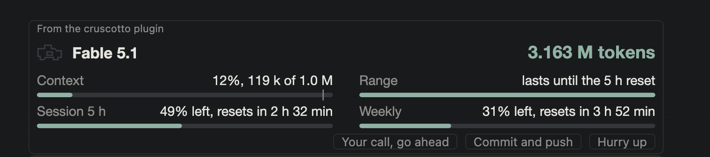

# cruscotto

A quiet instrument strip above the Claude Code prompt, in the spirit of a
nineties night-lit dashboard: four thin bars, one check-engine lamp, and
three buttons for the prompts you send most often.



## What it shows

| Gauge | Reading |
|---|---|
| Context | How full the context window is, with a tick at the auto-compaction threshold |
| Range | At the current pace, how much of the 5-hour window is still left when it resets, or when it runs out before that |
| Session 5 h | Share of the 5-hour rate-limit window left, and when it resets |
| Weekly | Share of the 7-day window left, and when it resets; any other window the API reports gets its own bar |

The header carries the model in use and the total tokens counted, in
millions, kept across sessions. The total sums input, output, cache-read
and cache-write tokens of every turn.

The lamp stays a dim outline while everything is fine. It turns amber when
a window drops to 20% left or the context is within 20 points of
compaction, and red at 5% left, within 5 points of compaction, when a window
is used up, when the 5-hour window would run out within 30 minutes, or when
the last turn failed. The gauges say which; only what no gauge shows, a
failed turn, is written next to the lamp.

`/cruscotto` prints the raw readings, to compare with the Usage panel.

## Buttons

Each one submits a prompt as your own words:

- **Go ahead**: solve it, go ahead on your own, and explain how.
- **Commit and push**: stage everything, commit in the style of the last
  commits, push the current branch; no force push, no rebase.
- **Hurry up**: speed up, parallelize, say why it is slow
  and how long is left.

With the strip focused, the hotkeys are `g`, `c` and `h`. The texts live in
`hooks/actions.ts`.

### Your own buttons

Point the **Your buttons** setting at a Markdown file. Each `## Label`
heading is a button, the lines under it the prompt it sends:

```markdown
## Review
Review the diff and list the problems, worst first.

## Tests
Run the tests. Fix what fails, then run them again.
```

They draw after the built-in ones, with the digits 1 to 9 as hotkeys; a
digit works from the empty prompt too. Edit the file and the strip picks
it up at its next redraw. Turn **Prompt buttons** off to keep only yours.

## Settings

The gear at the right end of the buttons opens `/config`, where the
plugin's options live; the same screen appears once at install.

| Option | Default | What it does |
|---|---|---|
| Skin | night | The whole palette: night for dark themes, amber for a one-color nineties cluster, paper for light themes, mono for grey |
| Amber threshold | 20 | A bar turns amber, and the lamp with it, at this share left or less |
| Red threshold | 5 | The same for red |
| Prompt buttons | on | Show the three built-in prompt buttons |
| Your buttons | none | A Markdown file with your own buttons, see above |

A change there reloads the strip with the new values.

## Install

At the prompt of a terminal session:

```
/plugin install cruscotto --marketplace roby222/cruscotto
```

Answer `y` to add the marketplace, then pick the user scope: the strip
appears in that session right away and in every session after.

From a shell:

```
claude plugin install cruscotto --marketplace roby222/cruscotto
```

In the desktop app, where `/plugin` does not run: click + next to the
prompt box, then Plugins, Add marketplace with `roby222/cruscotto`, then Add
plugin.

A private repository installs only for people who can read it on GitHub and
whose machine already holds a git credential for github.com (an SSH key, or
`gh auth login` then `gh auth setup-git`).

## Surfaces

The strip is drawn as SVG on the desktop app and the VS Code extension. On
the terminal, which has no SVG, it is one line of text with the same values,
and the buttons draw as `[ label ]`.

## Tested on

macOS (Apple silicon) with the VS Code extension, Claude Code 2.1.301. The
module runs inside the engine's own sandbox, with no Node and no filesystem
access of its own, so nothing in it depends on the operating system; the
desktop app, the terminal, Windows and WSL have not been tried yet. Reports
are welcome as issues.

## Development

```
claude --plugin-dir <this folder>
claude plugin validate <this folder>
claude plugin test <this folder>
```

The engine writes `.claude-plugin/types/` on load, for the editor; it is
ignored by git. `tsc -p <this folder>` type-checks the module once those
types exist.

## Layout

- `.claude-plugin/plugin.json`: the manifest.
- `.claude-plugin/marketplace.json`: makes this repository installable.
- `hooks/register.tsx`: the hooks module, drawing and state.
- `hooks/dash.ts`: thresholds, lamp, range, SVG.
- `hooks/actions.ts`: the three buttons.
- `types/index.d.ts`: the state contract.
- `hooks/*.test.ts`: tests, run with `claude plugin test`.
