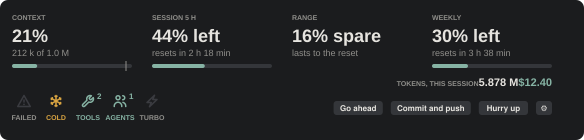
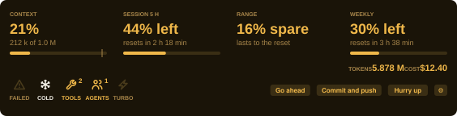
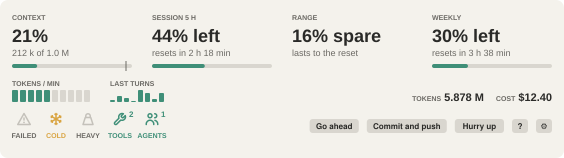
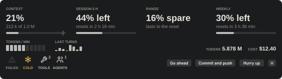

# cruscotto

A quiet instrument strip above the Claude Code prompt, in the spirit of a
nineties night-lit dashboard: a row of six lamps, four tiles with one live
number each, and three buttons for the prompts you send most often.



## What it shows

| Gauge | Reading |
|---|---|
| Context | How full the context window is, with a tick at the auto-compaction threshold |
| Session 5 h | Share of the 5-hour rate-limit window left, and when it resets |
| Weekly | Share of the 7-day window left, and when it resets; any other window the API reports gets its own bar |

Every tile has the same grammar: a small caps label, one large number that
is the live part, a short caption, and the bar where there is a quantity.
Under the tiles, a quieter status row: the lamps on the left, the odometer on
the right, the total tokens counted, in millions, kept across sessions. The
buttons follow, one under each tile.

The Range tile is a verdict, so it has no bar: at the pace of the last 90
minutes, does the 5-hour window last to its reset? "12% spare, lasts to the
reset" means yes, and little to spare is the ideal, not a warning. "1 h 20
min, runs out before reset" means no: amber if that is 30 minutes or more
before the reset, red if it is within 30 minutes from now.

The total sums input, output, cache-read and cache-write tokens of every
turn.

The bars turn amber at 20% left, or within 20 points of compaction, and
red at 5%; both thresholds are settings.

## Lamps

Like the lamps of a car cluster: one state each, and none for what a bar
already shows. Each has its word under it; off, the glyph is a dim outline;
lit, glyph and word take its color, and hovering it tells why. Red means stop, amber means attention, green is
information.

| Lamp | Glyph | Lights when | Color |
|---|---|---|---|
| Failed | warning triangle | the last turn ended in error | red |
| Cost | coin | the session cost reaches the cost setting, $10 by default | amber |
| Cold | snowflake | the cache hit of the last turn is under 50%: the context is being paid at full price, as after a compaction | amber |
| Tools | wrench, with a count | tool calls are running right now | green |
| Agents | two people, with a count | subagents are running right now | green |
| Turbo | lightning bolt | the token rate of the last 5 minutes reaches 200 k/min | green |

In the terminal, lit lamps are words in the line: `TOOLS 2, COLD`.
`/cruscotto` lists them too.

`/cruscotto` prints the raw readings, to compare with the Usage panel.

## Buttons

Each one submits a prompt as your own words:

- **Go ahead**: solve it, go ahead on your own, and explain how.
- **Commit and push**: stage everything, commit in the style of the last
  commits, push the current branch; no force push, no rebase.
- **Hurry up**: speed up, parallelize, say why it is slow
  and how long is left.

VS Code and the desktop app draw them in your editor theme's button colors;
the plugin cannot change that. If the theme's blue clashes with the strip,
give the buttons the skin's greys in VS Code's `settings.json`; it applies to
every button of the editor:

```json
"workbench.colorCustomizations": {
  "button.background": "#34363a",
  "button.foreground": "#e6e4df",
  "button.hoverBackground": "#45474c"
}
```

With the strip focused, the hotkeys are `g`, `c` and `h`. The texts live in
`hooks/actions.ts`.

### Your own buttons

Point the **Your buttons** setting at a Markdown file. Each `## Label`
heading is a button, the lines under it the prompt it sends:

```markdown
## Review
Review the diff and list the problems, worst first.

## Tests
Run the tests. Fix what fails, then run them again.
```

They draw after the built-in ones, with the digits 1 to 9 as hotkeys; a
digit works from the empty prompt too. Edit the file and the strip picks
it up at your next prompt. Turn **Prompt buttons** off to keep only yours.

## Settings

The **Settings** button, the last of the row, opens `/config`, where the
plugin's options live; the same screen appears once at install.

| Option | Default | What it does |
|---|---|---|
| Skin | night | The whole palette: night for dark themes, amber for a one-color nineties cluster (attention in warm white, errors in saturated red, so they stand apart from the amber), paper for light themes, mono for grey |
| Amber threshold | 20 | A bar turns amber at this share left or less |
| Red threshold | 5 | The same for red |
| Lamps | on | Show the lamp row |
| Cost lamp | 10 | Session cost in USD that lights the cost lamp; 0 turns it off |
| Cold cache lamp | 50 | Cache hit share under which the cold lamp lights |
| Turbo lamp | 200000 | Tokens per minute that light the turbo lamp; 0 turns it off |
| Prompt buttons | on | Show the three built-in prompt buttons |
| Your buttons | none | A Markdown file with your own buttons, see above |

A change there reloads the strip with the new values.

### Skins

| night | amber |
|---|---|
|  |  |

| paper | mono |
|---|---|
|  |  |

The samples are drawn by the plugin's own code (`docs/skins.ts`), so they
match what the strip shows.

## Install

At the prompt of a terminal session:

```
/plugin install cruscotto --marketplace roby222/cruscotto
```

Answer `y` to add the marketplace, then pick the user scope: the strip
appears in that session right away and in every session after.

From a shell:

```
claude plugin install cruscotto --marketplace roby222/cruscotto
```

In the desktop app, where `/plugin` does not run: click + next to the
prompt box, then Plugins, Add marketplace with `roby222/cruscotto`, then Add
plugin.

A private repository installs only for people who can read it on GitHub and
whose machine already holds a git credential for github.com (an SSH key, or
`gh auth login` then `gh auth setup-git`).

## Surfaces

The strip is drawn as SVG on the desktop app and the VS Code extension. On
the terminal, which has no SVG, it is one line of text with the same values,
and the buttons draw as `[ label ]`.

## Tested on

macOS (Apple silicon) with the VS Code extension, Claude Code 2.1.301. The
module runs inside the engine's own sandbox, with no Node and no filesystem
access of its own, so nothing in it depends on the operating system; the
desktop app, the terminal, Windows and WSL have not been tried yet. Reports
are welcome as issues.

## Development

```
claude --plugin-dir <this folder>
claude plugin validate <this folder>
claude plugin test <this folder>
```

The engine writes `.claude-plugin/types/` on load, for the editor; it is
ignored by git. `tsc -p <this folder>` type-checks the module once those
types exist.

## Layout

- `.claude-plugin/plugin.json`: the manifest.
- `.claude-plugin/marketplace.json`: makes this repository installable.
- `hooks/register.tsx`: the hooks module, drawing and state.
- `hooks/dash.ts`: thresholds, lamps, range, SVG.
- `hooks/actions.ts`: the three buttons.
- `types/index.d.ts`: the state contract.
- `hooks/*.test.ts`: tests, run with `claude plugin test`.
